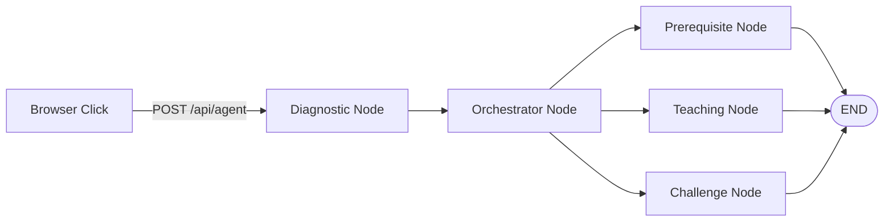
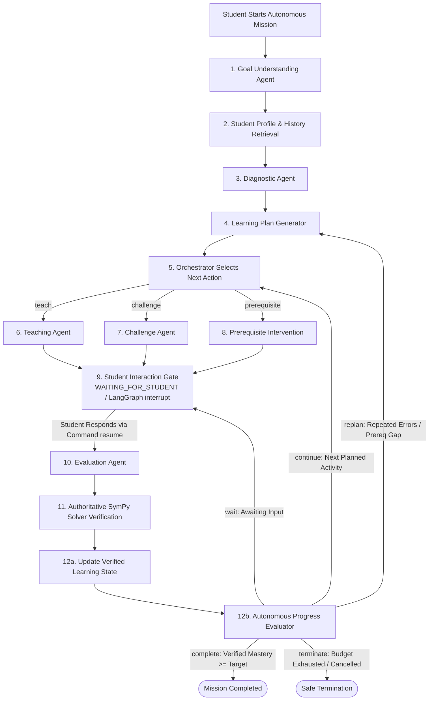

# 🐱 Oyen Math (v4 — Autonomous Agentic AI Learning Platform)

> **"Learn. Play. Level Up!"**  
> *An Autonomous Agentic AI-Powered Gamified Personalized Learning Platform for Malaysian SPM Additional Mathematics.*

[](https://github.com/TanSuChin/OyenMath)
[](https://github.com/TanSuChin/OyenMath)
[](https://github.com/TanSuChin/OyenMath)
[](https://www.sympy.org)
[](https://firebase.google.com)

---

## 🌟 1. System Identity & Overview

**Oyen Math** transforms the traditional struggle of Malaysian SPM Additional Mathematics into a heartwarming, hilarious, and intellectually rigorous autonomous learning adventure. Students embark on a goal-directed quest alongside **Oyen**—an adorable, determined orange tabby cat who dreams of overcoming hardship and building a better future for his family through the power of mathematics.

### Five Essential Autonomous Agentic Properties Implemented:
| Property | Implemented Capability | Evidence in Repository |
| :--- | :--- | :--- |
| **Goal-Directed Behaviour** | Establishes measurable mastery objectives (`target_mastery`, `goal_type`, execution budgets) and tracks progress until achievement or safe termination. | `agents/nodes/goal_understanding.py`, `agents/state.py` (`MissionGoal`) |
| **Autonomous Planning** | Generates and dynamically adjusts a multi-activity learning roadmap without requiring manual activity-by-activity navigation. | `agents/nodes/learning_plan.py`, `agents/nodes/orchestrator.py` |
| **Controlled Tool Utilisation** | Selects and invokes Pydantic-validated mathematical, diagnostic, curriculum, and planning tools with strict sandboxing and 5s timeouts. | `agents/math_tools.py`, `agents/schemas.py` (`TOOL_SPECS`, `run_tool`) |
| **Feedback, Verification & Reflection** | Evaluates student responses, verifies mathematical equivalence deterministically via SymPy, tags misconceptions (`forgot_c`, `wrong_power`, `sign_error`), and triggers prerequisite interventions or simpler explanations. | `agents/verification.py`, `agents/nodes/solver_verification.py`, `agents/nodes/state_updater.py`, `agents/nodes/progress_evaluator.py` |
| **Autonomous Execution & Persistence** | Executes multi-step decision loops in background worker threads with persistent atomic checkpoints, `WAITING_FOR_STUDENT` interrupts, pause/resume/cancel controls, and strict step/tool/duration budgets. | `agents/mission_runner.py`, `agents/checkpoint.py`, `server.py` |

---

## 🧠 2. Architecture: Before vs. After Transformation

### A. Legacy Architecture (v3 — Synchronous 5-Node Request-Response Pipeline)
Previously, `POST /api/agent` executed a single-turn acyclic pass (`START -> diagnostic -> orchestrator -> {prerequisite | teaching | challenge} -> END`) only when triggered by a browser click, with no persistent mission state, no background execution, and no multi-cycle replanning:



### B. New Autonomous Architecture (v4 — 12-Node Stateful LangGraph with Persistent Checkpointing & Native `interrupt()`)
Oyen Math v4 implements a persistent 12-node stateful `StateGraph(MissionState)` in `agents/graph.py` (`build_autonomous_mission_graph`) coordinated by `MissionRunner` (`agents/mission_runner.py`):



*(Note: The legacy `run_agent(payload)` pipeline and `POST /api/agent` endpoint remain 100% intact for backward compatibility with interactive map tutoring.)*

---

## 🔒 3. Authoritative Deterministic Math Verification & Security Hardening

In `agents/verification.py`, `agents/math_tools.py`, and `agents/schemas.py`:
- **SymPy as Sole Authority:** `calculate_verified_mastery()` only increases student mastery when `VerificationResult.is_correct` is deterministically verified by SymPy (`verified_by="sympy"`). Unverified LLM confidence can **never** increase mastery.
- **RCE Elimination & Safe AST Parsing:** Replaced unsafe `sp.sympify()` calls on definite integral bounds with strict regex and token-whitelisted parsing (`parse_bound`, `parse`).
- **Expanded SPM Variable Whitelist:** Supports standard SPM Additional Mathematics variables and constants ($x, y, t, u, v, r, h, k, \theta, \pi, e$) plus rate-of-change differentials ($dx, dy, dt$).
- **Explicit Indefinite Integral $+ C$ Verification:** Detects missing constants of integration (`forgot_c`) instead of blindly stripping $+ C$.
- **5-Second Execution Timeout Sandbox:** Prevents catastrophic polynomial/calculus expressions from hanging worker threads.

---

## 🌐 4. Autonomous Mission REST API & Ownership Security (`server.py` & `agents/auth.py`)

`server.py` runs on `ThreadingHTTPServer` (`socketserver.ThreadingMixIn`) and exposes:

| Method & Endpoint | Purpose |
| :--- | :--- |
| `POST /api/missions/start` | Create and start a new autonomous learning mission (supports `idempotency_key` and `background` mode). |
| `GET  /api/missions` | List missions owned by the authenticated student. |
| `GET  /api/missions/{mission_id}` | Retrieve full `MissionState` and `progress_summary`. |
| `GET  /api/missions/{mission_id}/status` | Retrieve live mission status, active agent, current activity, trace, and budget usage. |
| `POST /api/missions/{mission_id}/pause` | Pause an active mission. |
| `POST /api/missions/{mission_id}/resume` | Resume a paused mission from its latest valid checkpoint. |
| `POST /api/missions/{mission_id}/cancel` | Cancel and safely terminate a mission (`CANCELLED`). |
| `POST /api/missions/{mission_id}/respond` | Submit a student answer (`{"answer": "..."}`), resuming the LangGraph `interrupt()` through SymPy verification, state update, and autonomous replanning. |
| `GET  /api/missions/{mission_id}/history` | Retrieve completed activities, learning history, verified mastery progression, and misconceptions. |
| `POST /api/agent` | Legacy synchronous single-turn coaching endpoint (preserved for backward compatibility). |
| `POST /api/ocr` | Detective Oyen handwritten working OCR endpoint (Claude Vision). |

### Authentication & Student Ownership Isolation (`agents/auth.py`):
- **Firebase Cloud Mode (`FIREBASE_PROJECT_ID` or `js/firebase-config.js` configured):** Requires `Authorization: Bearer <Firebase ID Token>`. Validates token signature, expiration (`exp`), audience (`aud`), and issuer (`iss`), extracting `student_id` directly from the verified token claims. Missing/invalid tokens return `401 Unauthorized`.
- **Offline Development Mode (`dev-local`):** When Firebase is not configured, uses a clearly labelled `Offline Dev Mode (dev-local)` identity (or `X-Oyen-Dev-Student` header for local multi-student isolation tests) and never trusts `student_id` in the JSON request body.
- **Cross-Student Isolation:** Any attempt by Student B to view, pause, resume, respond to, or cancel Student A's mission returns `403 Forbidden`.

---

## 🖥️ 5. Autonomous Mission Dashboard (`🤖 Misi Autonomi AI`)

Integrated into `index.html` via `js/mission-dashboard.js`:
1. **Mission Overview:** Objective description, target SPM topic (`dif`, `integ`, `ind`, `quad`), live status badge (`RUNNING`, `WAITING_FOR_STUDENT`, `PAUSED`, `COMPLETED`, `CANCELLED`, `BUDGET_EXHAUSTED`), identity mode badge, and progress bar toward target mastery.
2. **Mission Controls:** Start, Pause, Resume, Stop/Cancel, Refresh, and New Mission controls.
3. **Interactive Student Participation Workspace:** Clearly distinguishes active agent execution from `WAITING_FOR_STUDENT`, displaying Oyen's guided teaching steps, challenge questions, and deterministic SymPy verification feedback.
4. **Generated Learning Plan Roadmap:** Displays Completed (`✅`), Current (`▶️`), and Upcoming (`⏳`) activities.
5. **AI Activity Monitor & Learning Results:** Live LangGraph decision trace, Initial vs. Verified Mastery, Identified Misconceptions, Completed/Answered counts, and Agent Step / Tool Call budget usage.

---

## 🚀 6. Quick Start & Running Tests

```bash
# 1. Install dependencies
pip install -r requirements.txt

# 2. Start the threaded server on http://localhost:8080
python server.py

# 3. Run the automated Python test suite (269 tests)
python -m unittest discover -s tests -p "test_*.py"

# 4. Run the JavaScript test suite (12 tests)
node tests/test-suite.js
```

---

## ⚠️ 7. Remaining Limitations & Optional External Configuration
- **Anthropic API Key Optional:** Without `ANTHROPIC_API_KEY` in `.env`, all 12 autonomous LangGraph nodes and `/api/agent` execute in deterministic rule-based mode, and handwritten OCR falls back to in-browser Tesseract.js instead of Claude Vision.
- **Firebase Cloud Mode Optional:** Live cloud sync and Firebase ID token verification require configuring a Firebase project in `js/firebase-config.js` and `FIREBASE_PROJECT_ID` in `.env`. Without it, checkpoints persist atomically on local disk under `.oyen_data/missions/{student_id}/{mission_id}.json`.
