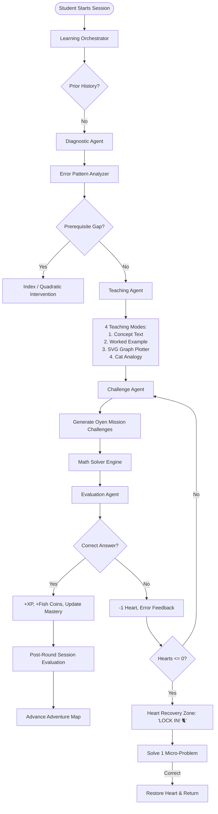

# 🐱 Oyen Math

> **"Learn. Play. Level Up!"**  
> *An Agentic AI-Powered Gamified Personalized Learning Platform for SPM Additional Mathematics.*

[](https://github.com/TanSuChin/OyenMath)
[](https://github.com/TanSuChin/OyenMath)
[](https://github.com/TanSuChin/OyenMath)
[](https://firebase.google.com)

---

## 🌟 1. System Identity & Overview

**Oyen Math** transforms the traditional struggle of Malaysian SPM Additional Mathematics into a heartwarming, hilarious, and intellectually stimulating adventure. Instead of sterile spreadsheets and dry textbooks, students embark on an educational quest alongside **Oyen**—an adorable, determined orange tabby cat who dreams of overcoming hardship and building a better future for his family through the power of mathematics.

### Brand Personality:
- **Playful & Curious:** Cat behavior, chasing butterflies, funny food distractions.
- **Intelligent & Rigorous:** Deep conceptual grounding in Form 5 SPM Additional Mathematics (Differentiation & Integration).
- **Encouraging & Warm:** Supportive feedback that lifts students up without ever mocking mistakes.
- **Malaysian Teen Culture & Gen Z Humor:** Relatable SPM references, Cikgu advice, and memes ("Brain.exe has stopped working", "LOCK IN! 🐈", "Where did that negative sign wander off to? 💀").

---

## 🐾 2. The Mascot: Oyen the Orange Cat

Oyen is a small orange tabby cat with bright orange fur (`#FF8C24`), darker orange stripes (`#B84206`), large expressive sparkling eyes, a cream muzzle and belly (`#FFF0DF`), a pink nose, and a fluffy tail.

### The 8 Signature Expressions & Poses
1. **Happy Oyen (`happy`):** Celebrating correct answers with paws held high in victory, sparkling stars, and a joyful smile.
2. **Sad Oyen (`sad`):** Reacting to incorrect answers with drooping ears, glossy watery eyes, and a reassuring hug.
3. **Thinking Oyen (`thinking`):** Solving difficult problems with one paw on his chin, looking upward with floating math symbols ($\frac{dy}{dx}, \int f(x), x^2, +C$).
4. **Confused Oyen (`confused`):** Funny reaction to complex questions with a tilted head, swirl marks, sweatdrop, and "Brain.exe has stopped working" expression.
5. **Excited Oyen (`excited`):** Celebrating completed chapters and milestones, jumping with confetti and holding a golden salmon trophy.
6. **Determined Oyen (`determined`):** Wearing a red SPM A+ headband with a paw emblem, clenching fists, and firing up students: *"One more correct answer and Oyen gets his heart back. LOCK IN! 🐈"*.
7. **Sleeping Oyen (`sleeping`):** Curled up peacefully on a soft cream cushion with floating "Zzz" during resting/loading screens.
8. **Detective Oyen (`detective`):** Wearing a deerstalker detective cap and wielding a magnifying glass to inspect uploaded handwritten calculation steps line by line.

---

## 📖 3. Storyline: Oyen's Journey

### Level 1: Differentiation — *"A Little Cat with Big Dreams"*
Oyen is a young orange cat growing up in a humble, financially struggling family in Malaysia. He attends school in worn-out sneakers and a patched school bag, determined to improve his family's circumstances. In Additional Mathematics class, he encounters **Differentiation**. Through mathematical challenges, Oyen learns about rates of change, tangents, gradients, and maximum/minimum values—realizing that small consistent changes every day compound into life-changing progress.

### Level 2: Integration — *"Putting the Pieces Together"*
*Direct continuation from Level 1.* Having conquered Differentiation, Oyen gains confidence and wins a school mathematics award. He sets his sights on designing a warm family shelter complete with a freshwater fish pond. However, calculating accumulated tile quantities, curved walls, and pool surface areas requires summing infinitesimal parts together. He discovers **Integration**—the reverse of differentiation!

### Prerequisite Interventions:
- **Chapter 0A: Laws of Indices (`ind`)** — Essential foundation for handling fractional and negative powers before differentiation.
- **Chapter 0B: Quadratic Functions (`quad`)** — Mastering axis of symmetry, parabolas, and vertices to model architectural roof structures.

---

## 🧠 4. Agentic AI Architecture (LangGraph Multi-Agent System)

Oyen Math coordinates specialized AI agents within a stateful LangGraph directed acyclic graph:



### Agent Roles:
1. **Learning Orchestrator (`OyenOrchestrator`):** Monitors learning fatigue, routes questions, triggers prerequisite interventions, and adjusts session flow.
2. **Diagnostic Agent (`OyenDiagnosticAgent`):** Screen concept readiness and identifies algebraic/calculus misconceptions.
3. **Teaching Agent (`OyenTeachingAgent`):** Delivers multimodal instruction across text, step-by-step examples, SVG graph plots with tangents/areas, and cat analogies.
4. **Challenge Agent (`OyenChallengeAgent`):** Presents questions framed as Oyen's missions with adaptive difficulty (Levels 1, 2, 3).
5. **Evaluation Agent (`OyenEvaluationAgent`):** Validates symbolic/numerical equivalence and powers the **Detective Oyen Working Inspector**.
6. **Math Solver Tool (`OyenMathEngine`):** Fast, non-hallucinating numerical multi-point evaluator supporting polynomials, fractions, and indefinite integrals ($+ C$).

---

## 🔍 5. Detective Oyen: Handwritten Calculation Inspector

Students can upload a photo of their notebook work, draw on an interactive canvas, or test curated SPM scenarios. Detective Oyen scans each line of derivation to catch common traps:
- **Differentiating constants into non-zero constants** (e.g. $9 \rightarrow 9$ instead of $0$).
- **Dropping exponents** without subtracting 1 ($4x^3 \rightarrow 12x^3$).
- **Omitting the constant of integration $+ C$** in indefinite integrals.
- **Arithmetic slips** in multi-step chains.

---

## 🎮 6. Gamification System

- **Hearts System (5 Max):** Mistake penalties with low-heart alerts.
- **Heart Recovery Zone:** Micro-exercises where every correct answer restores 1 heart.
- **Normal Points (XP) & Recovery Points:** Rewarded for accuracy and perseverance.
- **Fish Coins (`🐟`):** Collectible currency earned for perfect streaks.
- **Interactive Adventure Map:** Cat paw-prints connecting milestone nodes.
- **Malaysian Leaderboard:** Live ranking alongside fellow SPM candidates.
- **Cat Badges & Achievements:** Unlockable trophies celebrating mathematical mastery.

---

## 🎨 7. Brand Colors & UI Guidelines

| Color Name | Hex Code | Purpose |
| :--- | :--- | :--- |
| **Primary Orange** | `#FF8C24` | Main brand elements, active buttons, graph lines |
| **Dark Orange** | `#F06A16` | Headers, active titles, borders, high-contrast accents |
| **Light Orange** | `#FFF0DF` | Card backgrounds, pill badges, subtle highlights |
| **Cream Background** | `#FFF9F2` | Warm paper-like canvas background |
| **Dark Text** | `#30251F` | High-readability typography |
| **Pure White** | `#FFFFFF` | Cards, modals, scratchpad canvas |

---

## 🌐 8. Language Toggle (Bilingual SPM Support)

Full real-time toggle between **Bahasa Melayu (BM)** and **English (EN)** for Malaysian students under the Dual Language Programme (DLP):
- Story narratives
- Math questions & formulas
- Agent dialogue & thinking traces
- Inspector tips & feedback

---

## 🚀 9. Quick Start Guide

### Direct Browser Usage:
Simply open `index.html` in any modern web browser:
```bash
# On Windows PowerShell
Start-Process index.html
```

### Local Development Server (Python / Node):
```bash
# Python 3
python -m http.server 8080

# Or with Node
npx serve .
```
Navigate to `http://localhost:8080` in your browser.

---

## ☁️ 10. Firebase Integration

Oyen Math includes an offline-first architecture. If running without cloud credentials, it utilizes a local Firestore emulator backed by `localStorage`.

To connect live Firebase:
1. Create a Firebase project at [console.firebase.google.com](https://console.firebase.google.com).
2. Enable **Authentication** (Email/Password & Anonymous).
3. Enable **Cloud Firestore**.
4. Define `window.firebaseConfig` in `index.html` or through your environment:
```javascript
window.firebaseConfig = {
  apiKey: "YOUR_API_KEY",
  authDomain: "YOUR_PROJECT.firebaseapp.com",
  projectId: "YOUR_PROJECT",
  storageBucket: "YOUR_PROJECT.appspot.com",
  messagingSenderId: "SENDER_ID",
  appId: "APP_ID"
};
```

---

## 🐾 License

Oyen Math is created for Malaysian SPM students and educators.  
**"Learn. Play. Level Up!"** 🐱🧡

---

## 🆕 v2 update: fun layer, chubby Oyen, real OCR

- **Home:** zig-zag column of topic circles; tap one and its sub-topic circles pop out below (`js/home-map.js`). Integration unlocks after 40% Differentiation mastery.
- **Chubby Oyen:** new round orange tabby with blink, breathing and tail-wag animation (`js/oyen-fat.js`), used for all 8 poses.
- **Animated story:** each topic opens with a short animated chapter (`js/story.js`); replay with the 🎬 circle.
- **Answer-sheet OCR:** "📷 Scan Answer Sheet" in every question, plus the Detective tab. The photo goes to `POST /api/ocr` (Claude vision, needs `ANTHROPIC_API_KEY` in `.env`, see `.env.example`). Without a key it falls back to in-browser Tesseract.js (weak on handwriting). The student confirms the read answer, then the deterministic Math Solver marks it through the agent graph.
- Run: `python3 server.py` (or `PORT=9000 python3 server.py`).
